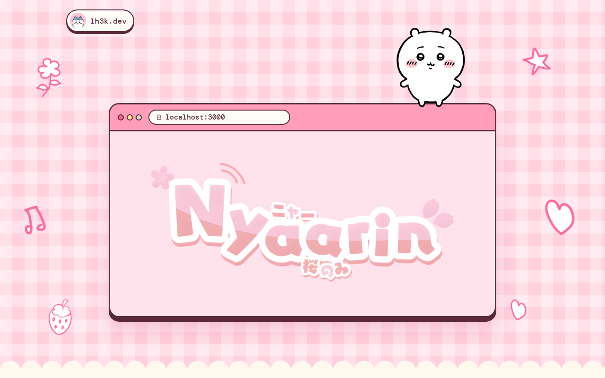

<p align="center">
  
</p>

<h1 align="center">lh3k.dev</h1>
<p align="center">localhost:3000, said fast.</p>
<p align="center">
  <a href="https://lh3k.dev">Visit the site</a>
</p>

My corner of the internet, and the small, cute apps I've made.

- Plain HTML, CSS and one small script. No build step.
- The doodles are my own pencil drawings, from [little fm](https://github.com/Nyaughh/little-fm).
- Star counts on the project cards come from GitHub on each visit.

<p align="center">
  <a href="docs/preview.png"></a>
</p>

### Run it

```bash
npx serve -l 3000
```

Then open `localhost:3000`, where it started. Pushes to `main` go live on [lh3k.dev](https://lh3k.dev) through Vercel.

`tools/make-doodles.py` redraws the doodles from little fm's drawing data. The link preview picture is `og.png`, a 1200×630 screenshot of `tools/og.html`.

Chiikawa and Hachiware are by Nagano. Their pictures here are the official art from [Chiikawa Pocket](https://gl.chiikawa-pocket.com/en/), used as a fan, and are not mine.
